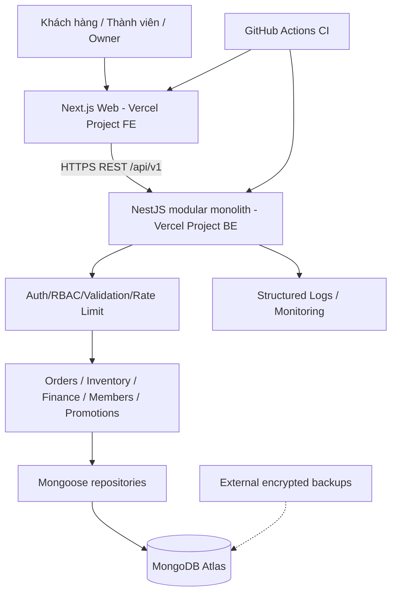

# SRS V2.0 — CÁ BỐNG SÔNG TRÀ
## Website bán hàng, quản trị đơn hàng, tồn kho, tài chính và đội ngũ

> **Trạng thái:** ĐẶC TẢ MỤC TIÊU / CHƯA XÁC NHẬN ĐÃ TRIỂN KHAI  
> **Ngày:** 10/10/2026 · **Phiên bản:** 2.0.0 · **Ngôn ngữ:** Tiếng Việt  
> **Stack mục tiêu:** Next.js (FE), NestJS (BE), MongoDB Atlas (DB), Vercel (FE/BE), GitHub Actions (CI).  
> **Nguồn gốc:** kế thừa SRS v1.2.0 người dùng cung cấp và quy tắc kinh doanh được chủ dự án xác định; các thiết kế kỹ thuật, threshold và quy trình mới là **đề xuất cần nghiệm thu**, không phải tình trạng phần mềm đã được kiểm chứng.

---

## 0. Quyết định thiết kế và nguyên tắc bất biến

| ID | Quyết định | Lý do / hệ quả |
|---|---|---|
| ADR-01 | Modular monolith NestJS + REST API; không microservices | Vừa đủ quy mô, tránh chi phí phối hợp |
| ADR-02 | MongoDB Atlas là **source of truth**; Google Sheets/Excel chỉ xuất báo cáo hoặc công cụ chuyển dữ liệu | Không có ghi hai chiều mâu thuẫn |
| ADR-03 | FE và BE là 2 Vercel Project độc lập trong 1 monorepo | Deploy và rollback rõ ràng |
| ADR-04 | Tiền lưu **integer VND**; mọi đơn lưu snapshot đơn giá, giá vốn, tỷ lệ chia, các loại phí | Báo cáo lịch sử không đổi theo bảng giá |
| ADR-05 | Đơn xác nhận giữ kho; xuất kho khi bàn giao/giao thành công theo quy trình; hủy giải phóng phần giữ | Chống oversell và double deduction |
| ADR-06 | Chính sách ghi nhận doanh thu thực hiện: chỉ khi đơn `DELIVERED`; tiền thu theo ledger riêng | Không lẫn đơn đặt, đơn giao và tiền đã thu |
| ADR-07 | Chia 60/40 trên **lợi nhuận đơn đủ điều kiện sau chi phí trực tiếp**; không chia trên doanh thu | Đúng thỏa thuận kinh doanh |
| ADR-08 | API xác thực, quyền và validation ở NestJS; frontend không phải biên bảo mật | Ngăn sửa dữ liệu qua API |
| ADR-09 | Ghi nhiều collection ảnh hưởng tiền/kho phải dùng transaction nếu tier hỗ trợ và đã test; nếu không, **block go-live hoặc đổi tier/thiết kế** | Không giả định Atlas Free tự động an toàn |
| ADR-10 | Không chạy queue/WebSocket/background loop thường trú bên trong Vercel Function | Khớp serverless runtime |
| ADR-11 | Vercel Hobby không dùng cho website kinh doanh; xác nhận gói thương mại phù hợp trước production | Tuân thủ điều khoản dịch vụ |
| ADR-12 | Không khẳng định đạt hiệu năng/bảo mật trước khi đo và kiểm thử | Mục tiêu khác với kết quả |

### 0.1 Phạm vi v2.0
**P0 — đưa vào vận hành:** storefront, đơn đa SKU, kho/lô/hạn dùng, checkout chống spam, phân quyền owner/member, theo dõi đơn, chi phí trực tiếp, chia hoa hồng, báo cáo cơ bản, nhật ký, backup/restore và CI/CD.

**P1 — sau khi lõi ổn định:** khách quay lại, KPI nâng cao, khuyến mãi có giới hạn, quản lý đối soát, xuất báo cáo, dashboard theo nhóm khách/kênh, quản lý chi phí chung.

**P2 — sau khi có dữ liệu sử dụng:** loyalty, automation marketing, analytics chuyên sâu, tích hợp dịch vụ giao hàng/thanh toán, tối ưu chiến dịch.

**Ngoài phạm vi:** ERP phức tạp, đại lý/nhượng quyền, nhiều kho phân tán, thanh toán thẻ tự động chưa có nhà cung cấp, realtime qua WebSocket, hệ thống AI recommendation, ứng dụng mobile native.

### 0.2 Bất biến nghiệp vụ không được phá
1. Chỉ có một kho hàng chung; thành viên không giữ stock riêng và không tùy ý giảm giá.
2. Khối lượng tịnh SKU là **300g/400g/600g gồm cá và nước kho, không gồm bao bì**; không gọi khối lượng cá riêng.
3. Bảng giá thử nghiệm: 300g **109.000đ**, 400g **139.000đ**, 600g **199.000đ**; giá nhập cơ sở lần lượt **65.000đ / 95.000đ / 140.000đ**. Giá vốn thực theo lô mới là cơ sở quyết toán; giá khác trong SRS cũ (83k/119k) là trường hợp chưa xác minh, tuyệt đối không tự áp dụng.
4. Lợi nhuận chia đơn = **số tiền thuộc doanh thu đơn sau hoàn/giảm liên quan - giá vốn lô thực xuất - chi phí trực tiếp shop chịu của đơn**; phí thu hộ không phải doanh thu kinh doanh nếu phải chuyển lại đơn vị vận chuyển. Phải có sổ đối soát tiền thu hộ.
5. Chủ shop 60%, người phụ trách 40% **chỉ với đơn thuộc chính sách áp dụng**. Đơn do chủ shop trực tiếp thực hiện: không tự tạo nghĩa vụ hoa hồng cho thành viên.
6. Đơn âm/0 lợi nhuận không phát sinh hoa hồng dương. Phát sinh lỗ được ghi nhận minh bạch, không tự chuyển lỗ sang thành viên.
7. Đơn hủy không tính doanh thu thực hiện, không có hoa hồng phải trả; hoàn/đổi sau giao phải tạo bút toán điều chỉnh.
8. Khách quay lại định danh bằng mã khách/SĐT chuẩn hóa; không dựa vào tên.
9. Dùng FIFO xuất kho theo lô nhập trước, đồng thời **chặn lô hết hạn**; cảnh báo lô gần hạn. Nếu chọn FEFO phải có quyết định chính sách và ghi log, không tự đổi ngầm.
10. Nhãn nhà sản xuất quyết định hướng dẫn bảo quản/hạn dùng. Dữ liệu bảo quản nội bộ chỉ là tham khảo, không tự cam kết 3–4 tháng ngăn mát hay 1 tháng bên ngoài khi nhãn không xác nhận.

---

## 1. Bối cảnh và tiêu chí thành công

### 1.1 Mô hình
Bán cá bống Sông Trà Quảng Ngãi tại khu vực Quận 9/TP Thủ Đức, ưu tiên Võ Văn Hát, Lò Lu, Dĩ An; vốn thử nghiệm **3.000.000đ**, nhập hàng bán lại, không mặt bằng, 4 thành viên hỗ trợ bán. Kênh đầu là các Facebook Group địa phương; website hỗ trợ thông tin và ghi đơn. Chưa áp dụng đại lý/tồn kho riêng.

### 1.2 Tồn kho khởi đầu — dữ liệu kế hoạch, không phải số đã nhập
| SKU | Số hũ dự kiến | Giá nhập/hũ | Tiền nhập dự kiến |
|---|---:|---:|---:|
| CBST-300 | 15 | 65.000 | 975.000 |
| CBST-400 | 8 | 95.000 | 760.000 |
| CBST-600 | 5 | 140.000 | 700.000 |
| **Tổng** | **28** | | **2.435.000** |

Dự phòng dự kiến **565.000đ**. Không tạo sẵn các dòng nhập kho thật khi chưa có chứng từ nhận hàng.

### 1.3 KPI kinh doanh (tham khảo; không phải bảo đảm)
- Bán thử 20–30 hũ; khoảng 10 khách mua thật; đo số đơn mua lại và số khách duy nhất mua lại.
- Đánh giá doanh thu, lãi gộp, lãi sau chi phí trực tiếp, chi phí chung, lợi nhuận ròng, tiền thực thu, tồn/hạn dùng, số ngày quay vòng và hiệu quả từng size/nguồn khách.
- Không mở rộng khi chỉ thấy doanh thu tăng; cần cả lợi nhuận và dòng tiền dương phù hợp.

### 1.4 Personas
- `GUEST`: truy cập xem sản phẩm và gửi đơn; không xem thông tin nội bộ.
- `MEMBER`: tạo, tìm kiếm, xử lý đơn được giao, thấy KPI và hoa hồng **của bản thân**; không xem giá vốn và tài chính tổng (trừ khi có quyền rõ ràng).
- `OWNER_ADMIN`: toàn quyền cấu hình, giá, kho, người dùng, đối soát, khuyến mãi và báo cáo.
- **Không tự động cho phép MEMBER tự sửa commission, ownerMember hoặc giảm giá đã duyệt.**

---

## 2. Kiến trúc hệ thống



### 2.1 Công nghệ và phiên bản
- **Next.js** App Router, React, TypeScript; chọn phiên bản stable còn được hỗ trợ khi bắt đầu triển khai; lockfile khóa chính xác versions.
- **NestJS** trên Node.js runtime tương thích tài liệu Vercel; REST JSON, OpenAPI/Swagger; Zod hoặc class-validator + ValidationPipe (chọn một phương pháp chính, tránh quy tắc không nhất quán).
- **MongoDB Atlas Free** lúc test/ít traffic; Mongoose; production chỉ khi thử nghiệm concurrency, transactions, kết nối và backup/restore thành công.
- **Monorepo** pnpm workspaces; apps/web, apps/api, packages/contracts, packages/config. Không chia microservices.
- FE: TanStack Query nếu yêu cầu fetching tương tác; React Hook Form + Zod cho forms; CSS/Tailwind chọn theo hiện trạng code, **không bắt buộc viết lại UI đang ổn**.
- Test: Vitest/Jest + Supertest, Playwright E2E. ESLint + TypeScript strict + formatter.
- CI: GitHub Actions PR quality gates; CD Vercel Git Integration hoặc GitHub Actions Deploy **chọn một là chủ** để tránh deploy hai lần.

### 2.2 Serverless constraints
- NestJS chạy dạng Vercel Function, không phụ thuộc singleton in-memory để bảo đảm toàn cục.
- Không dùng in-memory lock/rate-limit/global version làm nguồn sự thật.
- Dùng cached Mongo connection ở module scope khi có thể; cấu hình `maxPoolSize`, timeouts; đo số kết nối và kiểm tra giới hạn Atlas.
- Nếu xử lý lâu: tách job định kỳ qua giải pháp scheduler/queue bên ngoài khi cần; webhook phải có idempotency.
- Đặt FE, BE, Atlas gần nhau về region khi platform cho phép; đo latency thực tế.
- Không cam kết <400ms mỗi request hoặc 60MB RAM trước khi có benchmark.

### 2.3 Cấu trúc source đề xuất
```text
ca-bong-song-tra/
├── apps/
│   ├── web/
│   │   ├── app/(store)/
│   │   ├── app/admin/
│   │   ├── components/
│   │   ├── features/
│   │   └── lib/api/
│   └── api/
│       └── src/
│           ├── main.ts
│           ├── common/{guards,filters,interceptors,pipes}/
│           ├── modules/{auth,users,products,customers,orders,inventory,
│           │            promotions,commissions,finance,analytics,audit,health}/
│           └── database/
├── packages/{contracts,config}/
├── docs/{SRS.md,ADRs,runbooks}/
├── .github/workflows/{ci.yml,security.yml}/
├── pnpm-workspace.yaml
└── README.md
```

### 2.4 HTTP/CORS
- API public hostname riêng (`api.example...` khi có domain), FE hostname riêng. Cho phép CORS origin tường minh; `credentials` chỉ nếu cần cookie cross-origin.
- Khuyến nghị same-site custom domains để vận hành secure cookies dễ hơn; nếu vẫn dùng hai domain `vercel.app`, xác thực cookie cần xem xét cross-site behavior; ưu tiên FE BFF/proxy cùng origin hoặc giải pháp token bảo mật được thiết kế rõ.
- Các response lỗi chuẩn hoá; không expose stack traces, database errors, secrets.

---

## 3. Bộ trạng thái và workflow nghiệp vụ

### 3.1 Đơn hàng
`PENDING → CONFIRMED → PACKING → SHIPPING → DELIVERED`.

Nhánh hủy: `PENDING/CONFIRMED/PACKING → CANCELLED`; `SHIPPING` cần xử lý giao thất bại/trả hàng: `DELIVERY_FAILED` → `RETURNED` hoặc `SHIPPING` retry. Sau `DELIVERED`, trả/hủy doanh thu qua `REFUNDED`/`PARTIALLY_REFUNDED` (không xóa đơn).

Không cho chuyển trạng thái bất kỳ: một state-machine cấu hình allowed transitions. Lưu `statusHistory` actor, timestamp, old/new, reason.

### 3.2 Thanh toán
`UNPAID → PARTIALLY_PAID → PAID`; hoàn tiền `PARTIALLY_REFUNDED/REFUNDED` qua payment ledger. Giao thành công **không suy ra** đã nhận được tiền trừ khi workflow “Đã giao + đã thu” kiểm tra và ghi hai sự kiện cùng một giao dịch.

### 3.3 Kho
- `onHand`: số hũ đã nhận trừ số xuất kho cuối cùng, điều chỉnh mất/hỏng, cộng hoàn nhập hợp lệ.
- `reserved`: số giữ cho đơn đã xác nhận chưa xuất.
- `available = onHand - reserved`.
- Khi `CONFIRMED`, đặt giữ theo từng lô FIFO, atomic/transaction; không dựa vào đếm aggregate cũ.
- Khi giao/điều phối xuất thực, chuyển lượng reserved thành stock out **đúng một lần**; chọn điểm xuất kho nghiệp vụ duy nhất ở implementation (khuyến nghị `SHIPPING` với hàng đã rời kho); `DELIVERED` ghi nhận doanh thu, **không trừ lần hai**.
- Nếu đơn hủy trước xuất, bỏ reserved; nếu đã xuất, phải ghi hàng hoàn thực tế sau khi kiểm tra tình trạng, không tự tăng kho.
- Có `stockMovement` journal, reason, actor, orderId, batchId, before/after hoặc delta, idempotency key.
- Giao nhiều lô: allocations theo từng batch để tính COGS theo lô chính xác.
- Không dùng batch `expiresAt` đã quá hạn (theo timezone chính sách) để reserve; xuất kho hết hạn yêu cầu quyết định owner và phải phù hợp quy định an toàn thực phẩm, mặc định **từ chối**.

### 3.4 Idempotency và concurrency
- Mỗi request tạo đơn có `Idempotency-Key`, unique theo actor/operation hoặc khách/session; kết quả lần đầu được replay an toàn.
- Unique order code, không dựa vào random 4 ký tự để bảo đảm duy nhất; dùng sequence có kiểm soát hoặc ID đủ độ phân biệt.
- Mỗi transition được kiểm tra `version` và trạng thái; optimistic concurrency + atomic conditional update, với transaction cho multi-document.
- Bắt buộc thử 2 người cùng mua hũ cuối cùng, double-click, retry network, timeout sau commit, webhook duplicated.
- Nếu MongoDB deployment không hỗ trợ tính nhất quán cần thiết trong bài test, **không bật đặt hàng công khai** cho đến khi nâng tier hoặc dùng mô hình bảo đảm tương đương.

---

## 4. Đặc tả chức năng chi tiết (FR)

### FR-001 Product catalog và storefront — P0
- 3 SKU: `CBST-300`, `CBST-400`, `CBST-600`; công khai `netWeightG`, tên, retailPrice, hình ảnh thật, mô tả phù hợp nhãn.
- Trang danh sách/chi tiết mobile-first, CTA đặt hàng rõ, link liên hệ.
- Khi hết hàng (`available < requested`), hiển thị hết hàng/không cho đặt thành công; FE hiển thị chỉ là gợi ý, BE kiểm tra lại.
- Giá public lấy từ DB/cache kiểm soát; giá của đơn chốt lấy snapshot server, không tin payload tiền từ browser.
- Nội dung bảo quản/hạn dùng lấy dữ liệu đã duyệt với nguồn nhãn, không quảng cáo bảo đảm chưa được xác minh.
- SEO metadata, sitemap, OpenGraph; ảnh lazy load phù hợp; alt text.
- **AC:** thay giá trong admin cập nhật public theo TTL/invalidation; đơn cũ giữ nguyên price snapshot.

### FR-002 Cart và public checkout — P0
- Cart nhiều SKU/số lượng; form tên, SĐT, địa chỉ, khu vực, ghi chú; bắt buộc đồng ý thông báo xử lý dữ liệu cá nhân phù hợp chính sách.
- Chuẩn hóa SĐT Việt Nam; chống spam và validate độ dài, số lượng, miền dữ liệu; IP throttling + bổ sung verification/challenge khi có dấu hiệu abuse.
- Hiển thị breakdown sản phẩm, phí giao dự kiến, tổng phải trả; nơi không có ship chính xác phải nêu ship sẽ xác nhận.
- POST server tạo đơn PENDING, trả mã đơn; gửi lặp idempotent; không cho client ghi ownerMember tùy ý.
- Chưa tự ghi nhận `PAID` hoặc doanh thu thực hiện khi nhận request.
- **AC:** double-click checkout không tạo 2 đơn; input thay giá/discount sẽ bị bỏ qua hoặc lỗi validation.

### FR-003 Authentication và RBAC — P0
- Owner tạo/invite thành viên; login email/password, logout, reset password có token một lần TTL và rate limit; tắt user thu hồi session.
- Password hash Argon2id (hoặc bcrypt nếu có lý do), salt độc lập, không lưu plaintext; không có password trong response hoặc log.
- Session: ưu tiên opaque server-side session ID hash trong DB + HttpOnly Secure SameSite cookie, rotation khi login, idle/absolute expiry, revoke trên logout/reset/inactive; nếu JWT thì phải định nghĩa revocation/rotation rõ.
- Guards kiểm tra danh tính, role, ownership trên **mọi** endpoint nhạy cảm; member query luôn lọc theo memberId từ session, không tin query param.
- Thay owner phụ trách đơn chỉ owner có quyền và có audit; khi payout đã khóa phải thực hiện điều chỉnh riêng.
- **AC:** member A không đọc/sửa order của B kể cả thay ID; inactive member không gọi được API.

### FR-004 Order management — P0
- Owner: list/filter theo thời gian, trạng thái, member, khách, kênh, SKU; search mã đơn/SĐT với quyền phù hợp.
- Member: chỉ đơn được giao/tạo theo policy, nút tạo đơn nhanh, cập nhật trạng thái được phép; không xem lãi owner/COGS.
- Đơn đa SKU: item list chuẩn hóa, qty, unitSellingPrice, cost allocations, discount allocation.
- Popup fast action: “Xác nhận”, “Đã giao + thu đủ” nhưng phải hiển thị xác nhận, tổng thu, phương thức, người thực hiện, quyền và các bước được state-machine chấp nhận.
- Sửa đơn sau xác nhận phải release và re-reserve chênh lệch trong transaction; sửa sau giao không ghi đè lịch sử, tạo adjustment/refund.
- Mọi trạng thái lưu timestamps, actor, logs; soft delete nếu cần, không xóa nghiệp vụ tài chính.
- **AC:** truy cập trái quyền 403; thay đổi đơn cập nhật tồn kho và báo cáo nhất quán.

### FR-005 Customers — P1
- Tạo/customer matching bằng phoneE164/phoneNormalized (sau khi validate); tránh trùng, merge có log và quyền owner.
- `customerId` cố định; lưu nguồn khách, khu vực, liên lạc được phép, feedback thật.
- Chỉ tính mua lại dựa trên **đơn DELIVERED đủ điều kiện** và customerId: `repeatOrders` = số đơn thành công sau đơn thành công đầu; `returningCustomers` = số khách duy nhất có >=2 đơn thành công.
- Không đưa số điện thoại đầy đủ vào analytics/logs; member chỉ được truy cập thông tin liên hệ cần cho đơn của mình.

### FR-006 Batch inventory — P0
- Owner thêm phiếu nhập kho sau nhận thực tế: lotCode, SKU, receivedAt, expiresAt, qty, unitPurchaseCost, inboundShippingAllocated, landedUnitCost, chứng từ/ảnh nhãn.
- Hỗ trợ cost: landedUnitCost = unitPurchaseCost + phần phân bổ cước nhập và chi phí nhập trực tiếp (nếu đã chọn chính sách); không cộng cước nhập lại lần nữa vào lợi nhuận.
- Truy vết nhập/giữ/xuất/hoàn/hỏng/điều chỉnh; không sửa cứng `onHand` thiếu movement.
- Cảnh báo gần hạn cấu hình 7/14/30 ngày; out-of-stock và tồn âm phải là bất biến bị chặn.
- Báo cáo tồn theo SKU, batch, allocated/reserved, lô sắp hết hạn, giá trị tồn theo giá vốn lô.
- **AC:** thử 2 requests cạnh tranh hũ cuối cùng; tối đa một đơn reserve thành công.

### FR-007 Members và trách nhiệm đơn — P0
- Hồ sơ thành viên: memberId, name, email, phone, role, status, commissionRate effectiveFrom/effectiveTo, onboardedAt.
- Default member 40% trong chính sách chia lợi nhuận; thay đổi chỉ áp dụng đơn mới từ thời điểm hiệu lực hoặc khi owner xử lý đặc biệt có audit.
- Member có chỉ tiêu theo tháng (mốc 10/20/30/50 hũ chỉ là mục tiêu, **không tự sinh thưởng**).
- Theo dõi leadSource, người tìm khách, người chốt, người giao; 1 `responsibleMemberId` cho cơ chế chia tiêu chuẩn. Tranh chấp nguồn công phải owner xử lý trước payout.

### FR-008 Commission, KPI và payout — P0/P1
- Eligible khi `DELIVERED`, đối soát đủ tiền theo chính sách payout và không bị refund/cancel chưa xử lý; chỉ owner duyệt payout.
- `recognizedOrderRevenue` = giá trị sản phẩm sau giảm + phí giao thuộc doanh thu của shop (nếu thu và giữ) + điều chỉnh hợp lệ; không bao gồm tiền thu hộ chuyển cho hãng ship.
- `distributableProfit` = recognizedOrderRevenue - COGS theo lô - chi phí trực tiếp bên shop chịu, sau phân bổ; nếu chưa có số cước/thu hộ thì trạng thái `COMMISSION_PENDING_COST`.
- `memberCommission` = `max(0, distributableProfit) × 0.4` với quy tắc làm tròn VND xác định; `ownerOrderShare` = `distributableProfit - memberCommission` (nếu member eligible); owner direct sale => memberCommission=0, ownerOrderShare=distributableProfit.
- Lợi nhuận ròng dự án = tổng distributableProfit - commission - **chi phí chung chưa phân bổ vào đơn** - điều chỉnh và tổn thất phù hợp; không gọi `ownerOrderShare` là lợi nhuận ròng.
- Snapshot commissionRate và formulaVersion trên mỗi đơn; record `commissionAccrual`, `payout`, `adjustment`; payout có idempotency và approve actor.
- KPI gồm số đơn tạo, số giao thành công, số hũ theo SKU, doanh thu thực hiện, lợi nhuận chia, hoa hồng phát sinh, đã trả/chưa trả, tỷ lệ huỷ, khách quay lại, nguồn khách.
- **Ví dụ:** 600g bán 199.000, cost 140.000, shop chịu direct cost 15.000 → base 44.000, member 17.600, owner 26.400. Ví dụ không bao gồm overhead.
- **AC:** thay bảng giá/cost tương lai không đổi commission lịch sử; refund phải tạo clawback/adjustment thay vì xóa payout cũ.

### FR-009 Promotions — P1
- Chương trình có code, tên, hình thức `PERCENT/FIXED`, maxDiscount, minSubtotal, thời gian hiệu lực có timezone, số lượt áp dụng, perCustomerLimit, allowedSKU, allowedChannel, status, owner approval.
- Tính ở BE, atomic redeem cap / reservation theo checkout, chống áp dụng hai lần; không cộng chồng trừ khi rule cho phép.
- Giá sale hiển thị đúng thời hạn; phân bổ discount xuống line item để tính lãi theo SKU.
- Báo cáo số đơn, số tiền giảm, doanh thu/lợi nhuận sau ưu đãi; không phát hành voucher vượt biên lợi nhuận cấu hình khi chưa có phê duyệt.
- **AC:** hết hạn / quá lượt / không đủ điều kiện => 422 có mã lỗi chuẩn; tạo đơn retry không dùng 2 lượt.

### FR-010 Finance và cash ledger — P0/P1
- Tách rõ: gross product sales, discounts, recognized revenue, COGS, direct expense, gross margin, member commission, overhead, net profit, cash in/out.
- Collections payments/expenses/commissionPayouts; phân biệt khách đã trả, COD hãng đang giữ, shop đã nhận, tiền hoàn, công nợ phải thu/phải trả.
- Tổng thu chi theo khoản phát sinh và theo cash date, không suy ra dòng tiền từ trạng thái đơn.
- Owner tạo expenses: cước nhập, ship shop chịu, đóng gói, marketing, hao hụt, khác; đặt `expenseScope=ORDER/BATCH/OVERHEAD` để tránh double count.
- Owner duyệt chi phí thay đổi sau khi giao, hệ thống tạo adjustment lãi/hoa hồng và đánh dấu báo cáo cần đối soát.
- **AC:** ví dụ chi phí nhập đã cộng landed cost thì không trừ như một khoản expense COGS lần hai trong báo cáo profit.

### FR-011 Reports/Dashboard — P0/P1
- Thời gian mặc định múi giờ `Asia/Ho_Chi_Minh`, report dựa trên sự kiện thực hiện; lọc ngày tuần/tháng, nguồn khách, SKU, member.
- KPI: units delivered, orders delivered, net revenue, gross profit, direct-profit, owner share, commission, overhead, net profit, cash balance/movement, inventory on hand/available/reserved, repeat orders, unique returning customers.
- Biểu đồ theo ngày/size/kênh; loading, empty, error states; report hiển thị `asOf` và ghi rõ số liệu pending cost.
- Query aggregate tại backend có indexes; pagination; export CSV/XLSX chỉ Owner và bảo vệ PII.
- Không lưu bảng KPI mutable như nguồn số thật; aggregate/rebuild được từ transactions và ledgers.

### FR-012 Sync/freshness — P1
- Sau write thành công, invalidate client queries liên quan, refresh UI; stale-while-revalidate cho views ít nhạy cảm.
- Admin active có thể polling 30–60s **có giới hạn**; dừng khi hidden/offline, exponential backoff khi lỗi.
- Backend có `updatedAt`/version theo record; ETag chỉ khi chi phí tính hợp lý; không query DB toàn bộ mỗi 30s chỉ để lấy hash.
- Màn hình kho/phê duyệt commission xác nhận phiên bản mới khi thao tác; không dựa polling để ngăn race conditions.

### FR-013 Audit / operations — P0
- Ghi `actorId`, action, entityType, entityId, timestamp UTC, requestId, old/new redacted, IP hash/metadata tối thiểu, reason; chặn việc sửa log bằng UI thông thường.
- Không ghi raw password, token, full payment data, full PII vào log.
- Có health/liveness endpoint và error correlation ID; dashboard lỗi owner.
- Audit log là truy vết hỗ trợ, không thay thế ledger bất biến.

### FR-014 Privacy và tuân thủ — P0
- Công khai thông tin cửa hàng, liên hệ, chính sách bảo mật, điều kiện bán hàng/đổi trả và hướng dẫn bảo quản đúng nhãn.
- Chỉ thu thập dữ liệu khách cần cho giao hàng, truyền đạt mục đích và thời gian lưu; quyền xóa/điều chỉnh theo pháp luật áp dụng và nghĩa vụ lưu chứng từ.
- Không mặc định gửi quảng cáo qua số điện thoại nếu chưa có căn cứ/đồng ý hợp lệ.
- Kiểm tra các nghĩa vụ thương mại điện tử, thông tin nhãn thực phẩm, hóa đơn/thuế tùy mô hình pháp lý **trước production**; SRS này không phải tư vấn pháp lý.

---

## 5. Data model MongoDB (logical schema)

### 5.1 Collections
| Collection | Fields chính | Ràng buộc / index |
|---|---|---|
| `products` | `_id, sku, name, netWeightG, retailPriceVnd, status, images, labelInfo, updatedAt` | unique `sku`; tiền integer >=0 |
| `users` | `_id, emailNormalized, passwordHash, displayName, phoneNormalized, role, status, commissionPolicyId, createdAt` | unique `emailNormalized` |
| `sessions` | `_id, userId, sessionTokenHash, expiresAt, revokedAt, createdAt` | unique token hash; TTL index `expiresAt` (TTL không thay auth check) |
| `customers` | `_id, name, phoneNormalized, address[], area, consent, createdAt` | unique partial `phoneNormalized` theo policy |
| `orders` | `_id, orderCode, customerId, status, paymentStatus, items[], priceTotals, shipping, responsibleMemberId, source, version, timestamps, adjustments[]` | unique `orderCode`; `{responsibleMemberId,createdAt}`, `{customerId,createdAt}`, `{status,createdAt}` |
| `inventoryBatches` | `_id, sku, lotCode, receivedAt, expiresAt, receivedQty, onHandQty, reservedQty, unitPurchaseCostVnd, landedUnitCostVnd` | `{sku,receivedAt,expiresAt}`, unique batch identifier; check nonnegative |
| `inventoryMovements` | `_id, batchId, sku, orderId, type, qtyDelta, reservedDelta, idempotencyKey, actorId, createdAt` | unique `{type,idempotencyKey}` for relevant op; indexes batch/order |
| `payments` | `_id, orderId, direction, method, amountVnd, status, receivedAt, settlementRef, createdAt` | idempotency unique on external event/key |
| `expenses` | `_id, scope, orderId?, batchId?, category, amountVnd, paidAt?, paidBy, note` | `{scope,orderId}`, `{paidAt,category}` |
| `commissionAccruals` | `_id, orderId, memberId, baseVnd, rateBps, amountVnd, status, formulaVersion, createdAt` | unique `{orderId,memberId,formulaVersion,adjustmentSequence}` |
| `commissionPayouts` | `_id, memberId, period, accrualIds[], paidAmountVnd, status, approvedBy, paidAt, reference` | payout idempotency unique |
| `promotions` | `_id, code, type, value, constraints, startsAt, endsAt, usageLimit, usedCount, status` | unique `code`; enforce atomic usage |
| `auditLogs` | `_id, actorId, action, entityType, entityId, redactedDiff, requestId, createdAt` | `{entityType,entityId,createdAt}` |
| `idempotencyRecords` | `_id, scope, keyHash, requestHash, status, responseSafe, expiresAt` | unique `{scope,keyHash}`; TTL |
| `systemSettings` | `key, value, updatedBy, updatedAt` | unique key; whitelist allowed settings |

### 5.2 Mẫu document order (khái niệm)
```json
{
  "orderCode": "CBST-20261010-01HXYZ",
  "customerId": "customer-id",
  "status": "CONFIRMED",
  "paymentStatus": "UNPAID",
  "items": [
    {
      "sku": "CBST-300",
      "qty": 2,
      "unitPriceVnd": 109000,
      "lineDiscountVnd": 0,
      "batchAllocations": [
        {"batchId": "batch-id", "qty": 2, "landedUnitCostVnd": 65000}
      ]
    }
  ],
  "financialSnapshot": {
    "productSubtotalVnd": 218000,
    "discountVnd": 0,
    "shopShippingRevenueVnd": 0,
    "cogsVnd": 130000,
    "directCostsVnd": 0,
    "distributableProfitVnd": 88000,
    "commissionRateBps": 4000,
    "memberCommissionVnd": 35200,
    "ownerShareVnd": 52800,
    "formulaVersion": "v1"
  },
  "responsibleMemberId": "member-id",
  "version": 1
}
```
**Chú ý:** `financialSnapshot` trên là minh họa tại thời điểm định giá/allocate, chưa đủ điều kiện ghi nhận hoa hồng nếu đơn chưa giao, chưa thanh toán/đối soát chi phí. Trong triển khai cần phân biệt `estimated` và `recognized` rõ ràng.

### 5.3 Data governance
- Mongo timestamps lưu UTC ISO Date, hiển thị theo Asia/Ho_Chi_Minh.
- Không dùng `Number` floating để làm tiền tỷ lệ; integer VND, rate dạng basis points (40%=4000bps); làm tròn từng đơn với policy thống nhất: round half up về VND, phần chênh thuộc owner share.
- Không tự động migrate dữ liệu v1.2 từ Sheets khi thiếu cột chi phí, nguồn khách hay mapping ID; tạo import dry-run, reconciliation và owner sign-off.
- Transactions: session for order reserve + movements + order transition + idempotency state. Với retry, không gửi external side effects bên trong callback transaction; gửi notification sau commit có outbox nếu sau này cần.
- Không hứa strong atomicity chỉ nhờ Mongoose schemas; xác nhận DB tier, transactions và code qua integration test.

---

## 6. REST API contract sơ bộ `/api/v1`

### 6.1 Quy ước
- JSON UTF-8; timestamp ISO8601 UTC; đơn vị tiền VND integer; `X-Request-Id` để trace.
- Error format `{ "error": { "code": "OUT_OF_STOCK", "message": "...", "requestId": "...", "details": [] } }`.
- Pagination cursor hoặc `page/limit` có max; whitelist sort/filter; không truyền raw Mongo operator từ client.
- Trạng thái HTTP: 200/201 thành công, 400 cú pháp, 401 chưa auth, 403 không quyền, 404 không tìm thấy/không được tiết lộ, 409 xung đột version/tồn, 422 validation/business rule, 429 rate limit.
- OpenAPI là hợp đồng được generate/test đồng bộ; FE SDK typed từ spec.

| Method | Path | Role | Chức năng |
|---|---|---|---|
| GET | `/products` | public | Danh mục public |
| GET | `/products/:sku` | public | Chi tiết |
| POST | `/checkout/orders` | public | Tạo PENDING; idempotency + rate limit |
| POST | `/auth/login` | public | Login |
| POST | `/auth/logout` | authenticated | Thu hồi phiên |
| GET | `/auth/me` | authenticated | Profile/quyền |
| GET | `/orders` | owner/member scoped | List & filters |
| POST | `/orders` | owner/member | Đơn nội bộ |
| GET | `/orders/:id` | scoped | Xem đơn |
| PATCH | `/orders/:id` | scoped+state | Sửa khi chưa locked |
| POST | `/orders/:id/transitions` | scoped+state | Chuyển trạng thái, expectedVersion |
| POST | `/orders/:id/payments` | scoped+policy | Ghi nhận thanh toán |
| POST | `/orders/:id/refunds` | owner | Hoàn tiền & adjustment |
| GET | `/inventory/batches` | owner | Tồn lô |
| POST | `/inventory/receipts` | owner | Nhập kho |
| POST | `/inventory/adjustments` | owner | Điều chỉnh có reason |
| GET | `/inventory/movements` | owner | Lịch sử kho |
| GET/POST | `/users` | owner | List/create member |
| PATCH | `/users/:id` | owner | Lock/change policy |
| GET | `/commissions/me` | member | Hoa hồng bản thân |
| GET | `/commissions` | owner | Toàn bộ hoa hồng |
| POST | `/commissions/payouts` | owner | Chốt kỳ, tránh trả 2 lần |
| GET | `/dashboard/overview` | owner | KPI tổng |
| GET | `/dashboard/members/me` | member | KPI cá nhân |
| GET/POST/PATCH | `/promotions` | owner | Chiến dịch (P1) |
| GET/POST | `/expenses` | owner | Chi phí (P0 minimal) |
| GET | `/audit-logs` | owner | Kiểm toán |
| GET | `/health` | ops | Health không lộ bí mật |

### 6.2 Payload minh họa tạo đơn
```json
{
  "customer": {"name":"Khach hang", "phone":"09xxxxxxxx", "address":"Thu Duc", "area":"Lo Lu"},
  "items": [{"sku":"CBST-300", "qty":1}],
  "source":"FACEBOOK_GROUP",
  "notes":"Giao buoi chieu"
}
```
Server xác định `unitPrice`, phí/khuyến mãi được duyệt và người phụ trách. API từ member không được nhận `priceVnd`, `cost`, `memberCommission`, `role` từ client.

### 6.3 Contract chuyển trạng thái
```json
{
  "action": "CONFIRM",
  "expectedVersion": 3,
  "idempotencyKey": "client-generated-unique-value",
  "reason": "Khach xac nhan"
}
```
Phản hồi chứa order mới, `version` mới, trạng thái kho liên quan nếu người gọi được phép. Khi conflict `409` buộc UI refresh và người dùng xác nhận lại.

---

## 7. Bảo mật, chống spam và quyền riêng tư

### 7.1 Threat model tối thiểu
- Attacker sửa giá/chiết khấu ở client; đoán order IDs; credential stuffing; spam checkout; replay request; CSRF; XSS từ ghi chú khách; injection NoSQL; duplicate webhook; leaked service credentials; member truy cập dữ liệu đồng nghiệp; abuse báo cáo/export.

### 7.2 Quy định kỹ thuật
1. Mọi server mutation authenticate + authorize; ownership trong query DB; không tin `memberId` phía client.
2. DTO strict whitelist/forbid unknown; explicit projection; sanitize keys và query operators; giới hạn body size, qty, notes, page limit.
3. Cookie auth HttpOnly/Secure/SameSite theo topology; CSRF token/origin check cho cookie-based mutations; CORS allowlist cụ thể.
4. Argon2id hoặc bcrypt đã cấu hình đủ cost; password reset token hash + TTL + one time; rotate sessions; không log credential.
5. Rate limit tầng edge và API; **shared persistent store** nếu cần đếm xuyên functions; phân tầng IP+account+route; log 429/anomaly. In-memory throttle chỉ là phụ trợ, không là biện pháp chính.
6. Throttling checkout kết hợp honeypot/challenge có điều kiện, tránh gây khó cho khách thật; CAPTCHA không phải biện pháp duy nhất.
7. HTTP security headers, CSP triển khai tăng dần, content escaping, HTTPS; upload hình theo allowlist MIME/size và quét khi có upload.
8. Secrets trong Vercel env/GitHub Secrets, least privilege Atlas user; không commit `.env`, service credential; rotate khi nghi lộ.
9. DB network access: cấu hình giới hạn tối đa khả thi theo hosting; nếu Vercel không có fixed outbound IP ở gói dùng, ghi nhận rủi ro và bù bằng credentials hạn quyền/TLS/alert; không mở `0.0.0.0/0` mà không đánh giá.
10. Audit các thay đổi giá, chi phí, trạng thái, payout, role, tồn; hạn chế export dữ liệu khách và masking khi cần.
11. Backup mã hóa bằng khóa tách nơi lưu, ít người truy cập, retention, test restore; không lưu backup public GitHub Artifacts hoặc Vercel static assets.
12. Với sự cố lộ dữ liệu, có quy trình vô hiệu session, rotate credentials, chặn truy cập, đánh giá thông báo theo luật áp dụng.

### 7.3 Ma trận quyền
| Thao tác | Guest | Member | Owner |
|---|---:|---:|---:|
| Xem sản phẩm, checkout | ✔ | ✔ | ✔ |
| Đơn của bản thân | — | ✔ | ✔ |
| Đơn của member khác | — | ✘ | ✔ |
| Thay giá, vốn, ưu đãi | ✘ | ✘ | ✔ |
| Xem giá vốn, dòng tiền toàn shop | ✘ | ✘ | ✔ |
| Xem hoa hồng bản thân | ✘ | ✔ | ✔ |
| Nhập/điều chỉnh kho | ✘ | ✘ | ✔ |
| Chốt/trả hoa hồng | ✘ | ✘ | ✔ |
| Tạo/khóa thành viên | ✘ | ✘ | ✔ |
| Export PII | ✘ | ✘ | ✔ kiểm soát |

---

## 8. NFR — yêu cầu phi chức năng và SLO *mục tiêu thử nghiệm*

| ID | Mục tiêu | Cách kiểm chứng / điều kiện |
|---|---|---|
| NFR-PERF-01 | Storefront mobile LCP p75 ≤ 2.5s, CLS ≤ 0.1, INP ≤ 200ms | Field data sau đủ mẫu hoặc lab 4G giả lập và báo cáo rõ |
| NFR-PERF-02 | API read p95 ≤ 800ms, write p95 ≤ 1500ms tại tải nhỏ đã định nghĩa | K6/Artillery; ghi region, cold start/warm, 95th percentile; không coi SLA |
| NFR-PERF-03 | Admin thao tác đơn ít bước, phản hồi trực quan ngay và xác nhận từ server | Usability test với 2–4 người dùng thực |
| NFR-REL-01 | Không oversell, không duplicate order/stock movements/payout trong concurrency tests | 50–100 requests cùng SKU cuối, retry/fault injection |
| NFR-REL-02 | RPO đề xuất ≤ 24h, RTO đề xuất ≤ 4h cho MVP **nếu** có quy trình khả thi | Restore drill định kỳ, ghi kết quả; không hứa khi chưa test |
| NFR-SEC-01 | 100% endpoints sensitive có authn/authz integration tests | Test 401/403/IDOR/injection |
| NFR-SEC-02 | Không lộ secret/PII trong log, export hoặc public build | Static scan, manual review |
| NFR-OPS-01 | Có cảnh báo tỷ lệ lỗi 5xx, DB failure, backup failure và checkout failures | Test kích hoạt cảnh báo |
| NFR-ACC-01 | UI dùng tốt trên 360px, có labels, keyboard, contrast hợp lý | Axe + manual |
| NFR-COST-01 | Có cảnh báo khi usage Vercel/Atlas vượt ngưỡng vận hành đặt trước | Billing alerts/monitoring, kiểm tra hàng tuần |

Không tuyên bố zero downtime, zero memory leak, no data loss 100% hoặc DDoS-proof. DDoS mitigation là nhiều lớp, không thể bảo đảm chống mọi cuộc tấn công ở gói nhỏ.

---

## 9. CI/CD, môi trường và deploy

### 9.1 Environments
- Local: Mongo riêng local/test, `.env.local` không commit.
- Preview/Staging: FE/BE preview, database staging **tách production**, seed dữ liệu giả; không dùng PII thật.
- Production: FE/BE Vercel projects, Atlas db prod, domains + TLS, settings riêng.
- Không chạy migration/seed phá dữ liệu production lúc build.

### 9.2 Pipeline

```mermaid
flowchart LR
 PR[Pull Request] --> CI[GitHub Actions]
 CI --> L[Lint + Typecheck]
 L --> T[Unit + Integration]
 T --> S[Secret/Dependency Scan]
 S --> B[Build FE/BE]
 B --> PV[Preview Deploy]
 PV --> M[Review + Merge]
 M --> PD[Vercel Production Deploy]
 PD --> SM[Smoke tests + Monitoring]
```


- GitHub protected main: PR required, status checks required, least-privilege permissions, pin third-party actions to commit SHA in production workflows, dependency review.
- CI tasks `pnpm install --frozen-lockfile`, `pnpm lint`, `pnpm typecheck`, `pnpm test`, `pnpm build`, E2E smoke against staging when practical.
- Cấu hình 2 Vercel projects với root directory `apps/web`, `apps/api`; xác minh monorepo workspace dependency bundling, Nest entrypoint auto detection, build artifact size và function limits.
- Deployment preview không chạy transaction test destructive vào DB prod.
- CD rollback Vercel FE/BE tương thích API; DB migration kiểu expand→deploy→contract, backward compatible; rollback schema có runbook.
- Gói Vercel Hobby **không đáp ứng mục đích thương mại**: production cần gói phù hợp quy định hoặc alternative hosting; xác nhận ngân sách trước khi go-live.

### 9.3 Environment variables (tên gợi ý)
```dotenv
# API server only
NODE_ENV=production
MONGODB_URI=***
SESSION_SECRET=***
CORS_ALLOWED_ORIGINS=https://shop.example.vn
APP_BASE_URL=https://shop.example.vn
DATABASE_NAME=ca_bong_song_tra
# Web: chỉ public URL / settings không nhạy cảm
NEXT_PUBLIC_API_BASE_URL=https://api.example.vn/api/v1
```
Không đưa Mongo URI/session keys dưới tiền tố `NEXT_PUBLIC_`. Rate limiter shared storage URL/token bổ sung chỉ khi có dịch vụ thực tế.

---

## 10. Test plan, edge cases và acceptance criteria

### 10.1 Unit tests (bắt buộc)
- 3 SKU giá chính xác, khối lượng tịnh chính xác.
- Profit split: không phí, có ship shop chịu, ship khách chịu, COD pass-through, discount, chi phí nhập đã allocated, commission 0/lỗ, member vs owner, rounding.
- Chia tiền theo lô: 2 batch khác giá vốn, qty line đa SKU, partial returns và điều chỉnh.
- KPI: đơn PENDING/CANCELLED không tính revenue, repeat orders khác unique returning customers.
- Discount: min basket, SKU whitelist, hết hạn, max cap, usage limits và timezone.

### 10.2 Integration tests bắt buộc
| ID | Kịch bản | Kết quả |
|---|---|---|
| IT-01 | Hai đơn reserve cùng hũ cuối | 1 thành công, 1 409; onHand/reserved không âm |
| IT-02 | Double click checkout/retry same idempotency key | Chỉ một order, trả cùng kết quả |
| IT-03 | Retry transition SHIPPING sau timeout | Chỉ một stock-out movement |
| IT-04 | Cancel trước xuất | Release reservation đúng lô |
| IT-05 | Cancel/return sau xuất | Không tự nhập lại nếu chưa nhận hàng thật |
| IT-06 | Member A GET/PATCH order B | 403/404 theo policy, không rò dữ liệu |
| IT-07 | Đổi giá sau khi order đã giao | Snapshot và commission không đổi |
| IT-08 | Refund partial sau commission accrued/paid | Adjustment traceable, không xóa ledger |
| IT-09 | DB fail giữa multi-document transaction | Không tồn trạng thái nửa chừng |
| IT-10 | Lô hết hạn được thử reserve | Từ chối |
| IT-11 | Checkout spoof price/member/discount | Server từ chối/bỏ qua giá trị client |
| IT-12 | Member disabled, active session vẫn tồn tại | Tất cả request nhạy cảm bị chặn |
| IT-13 | Promo last slot concurrency | Không vượt usageLimit |
| IT-14 | Mongo backup + mongorestore | Dữ liệu, indexes và totals đối soát đúng |
| IT-15 | Mô phỏng webhook trùng sự kiện | Không ghi nhận thanh toán hai lần |

### 10.3 E2E theo persona
1. Guest xem sản phẩm → tạo đơn → nhận mã đơn.
2. Owner xác nhận → reserved đúng FIFO → packing/shipping → delivered + đối soát payment → ghi nhận profit và commission.
3. Member đăng nhập → tạo/xem đơn cá nhân → KPI riêng; không truy cập order member khác.
4. Owner tạo batch, đổi giá, mở promo, xem dashboard, duyệt payout; mọi thay đổi có audit.
5. Thử mạng chậm/offline, refresh, double-click, đổi tab trong khi member khác cập nhật.

### 10.4 Definition of Done / Go-live gates
- [ ] Source code review quyền sở hữu dữ liệu và money calculations.
- [ ] Integration test transactions Atlas tier thực dùng, concurrency và failure path đều pass.
- [ ] Không có P0/P1 security bugs còn mở (mức severity được định nghĩa trước release).
- [ ] Có backup encrypt và ít nhất 1 restore drill pass, chủ shop biết ai làm khi lỗi.
- [ ] Test trước 2–4 user trên điện thoại, checkout và admin critical flows.
- [ ] Vercel commercial plan/hosting phù hợp và Atlas network/security verified.
- [ ] Nội dung nhãn sản phẩm, phí giao, đổi trả, chính sách dữ liệu và thông tin cửa hàng được phê duyệt.
- [ ] Dữ liệu nhập từ Sheet nếu có được reconcile: counts, stock, outstanding payments, commissions.
- [ ] Owner ký xác nhận số tồn kho đầu, số dư tiền, công nợ và trách nhiệm team.
- [ ] Monitoring, alert, deployment rollback runbook được test.

---

## 11. Triển khai theo milestone/issue backlog

### M0 — Discovery & foundation (P0)
**Đầu ra:** ER model, role matrix, design decisions, monorepo skeleton, env, CI, deploy smoke, OpenAPI base, seed dữ liệu giả.
- [ ] Duyệt policy xuất kho lúc SHIPPING và ghi nhận doanh thu lúc DELIVERED.
- [ ] Chốt chi phí landed cost / direct cost / ship thu hộ.
- [ ] Kiểm tra Atlas transactions trên Free tier và network với Vercel.
- [ ] Quyết định auth topology (BFF same-origin vs direct API cross-origin).
- [ ] Thiết lập dev/staging/prod isolation, domain, budget alert.

### M1 — Bán hàng an toàn (P0)
**Đầu ra:** product, public checkout, order admin, login/session/RBAC, audit, idempotency; smoke E2E.
- [ ] 3 SKU và lịch sử giá.
- [ ] Order items đa SKU, orderCode unique, status machine.
- [ ] Login/reset/inactive, authorization all endpoints.
- [ ] Checkout validation, anti-spam, idempotency.

### M2 — Kho và tài chính cốt lõi (P0)
**Đầu ra:** batch + reservations/movements + COGS + payouts.
- [ ] Nhập lot, expire check, reserve FIFO, shipping allocation.
- [ ] Ledger thanh toán, COD settlement và expense.
- [ ] Lợi nhuận/hoa hồng đúng snapshot 60/40.
- [ ] Approve payout, adjustment, refund, reconcile.
- [ ] Concurrency/transaction tests pass trước go-live.

### M3 — Dashboard/khách quay lại (P1)
**Đầu ra:** views admin/member, revenue/gross/direct/net/cash, SKU/channel report, repeat customers.
- [ ] Aggregates query/indexed.
- [ ] Distinct repeat customers vs repeat orders.
- [ ] Reporting exports PII-safe.
- [ ] Data freshness và controlled polling.

### M4 — Campaigns và vận hành nâng cao (P1)
**Đầu ra:** approved promotions, caps, dashboards, runbook, alerts, restore cadence.
- [ ] Promotion eligibility và concurrent redemption.
- [ ] Cost/ROI campaign; ngừng nếu lỗ.
- [ ] Performance budgets, analytics, incident response.

### M5 — Review mở rộng (P2)
Chỉ thực hiện sau khi có dữ liệu đơn thật, tỉ lệ quay lại, tồn/hạn dùng, chi phí hosting và nút thắt kỹ thuật được đo.

---

## 12. Runbooks và quy trình vận hành

### 12.1 Mỗi ngày
- Owner xem PENDING quá lâu, SHIPPING chưa đối soát, lô gần hạn, đơn đổi/trả, commission pending cost, tiền COD chưa về.
- Member cập nhật trạng thái đơn đúng thực tế; không bấm “đã giao + thanh toán” nếu chỉ mới gửi shipper.
- Xem lỗi 5xx/login spam/checkout failures; đánh dấu sự cố bất thường.

### 12.2 Hàng tuần
- Đối soát số tồn thực với movement, chênh lệch lập phiếu điều chỉnh có người xác nhận.
- Đối soát doanh thu đã giao vs payments received vs COD receivable.
- Đối soát commission accrued vs payout; kiểm tra refunds và chi phí chung.
- Kiểm tra usage/budget Atlas/Vercel, backup artifact và expiry.

### 12.3 Khi DB / deploy gặp lỗi
1. Tạm dừng thao tác ghi nhạy cảm hoặc đưa checkout sang chế độ nhận liên hệ thủ công nếu không thể bảo đảm tồn kho.
2. Thu thập requestId, timestamp, deployment version, DB state; không chạy retry writes thủ công không idempotent.
3. Rollback frontend/backend tương thích schema hoặc deploy hotfix có review.
4. Nếu phục hồi DB, chọn recovery point, khôi phục môi trường tách biệt, đối soát payment/stock/commission trước cutover; không restore đè production vô điều kiện.
5. Postmortem: nguyên nhân, ảnh hưởng đơn/khách, corrective actions và người chịu trách nhiệm.

### 12.4 Migration từ Google Sheets v1.2.0
- Sheets v1.2.0 cũ có 9 tabs: `SAN_PHAM`, `KHO_HANG`, `DON_HANG`, `KPI_THANH_VIEN`, `THANH_VIEN`, `HOA_HONG_TAI_CHINH`, `KHUYEN_MAI_KPI`, `CAU_HINH`, `NHAT_KY`.
- Xuất bản snapshot read-only và backup trước cutover; mapping SKU/ID, mã đơn, trạng thái, owner, costs, lots và payout.
- Password lưu trong bảng cũ **không nhập plaintext**; tạo lại user/password invitation, bắt đổi pass.
- KPI tính lại từ đơn và ledger, không import KPI như nguồn sự thật. Những đơn `items_summary` Regex được parse trong import **chỉ làm bước migration**, cảnh báo khi không chắc; nhập `order.items[]` chuẩn.
- Không đoán cost lô hay phân bổ ship nếu dữ liệu thiếu: gắn `NEEDS_RECONCILIATION` và owner xác minh.
- Dry-run vào staging → đối chiếu số đơn/qty/doanh thu/ship/commission → sign-off → freeze writes trên Sheets → import prod → kiểm thử → switch traffic; mở đường rollback có deadline.

---

## 13. Rủi ro và phương án xử lý

| Rủi ro | Mức | Hướng giảm thiểu |
|---|---|---|
| Vercel Hobby không dùng thương mại | Cao | Pro/Enterprise hoặc hosting thay thế hợp lệ trước production |
| Atlas Free không có backup managed | Cao | Encrypted mongodump độc lập, restore drill, cân nhắc paid tier khi tăng doanh thu |
| Concurrency transactions / out-of-stock | Cao | Atomics, transactions kiểm chứng, idempotency, fail-closed, stress tests |
| Two-project FE/BE tăng complexity/CORS | Trung bình | Same-site domains/BFF, contract OpenAPI, logging correlated |
| Cold starts / DB connection overload | Trung bình | Reused connections, bounded pools, load test, region gần |
| Sai commission khi cost/ship thay đổi | Cao | Snapshot, `PENDING_COST`, adjustments, approval |
| Privacy/PII leak và brute-force | Cao | RBAC, least privilege, hashed auth, rate limit, encryption/access controls |
| Over-engineering trước có doanh thu | Trung bình | P0 only trước; P1/P2 dựa dữ liệu bán thật |
| Chi phí vận hành > lãi | Cao | Budget alert, monthly cost review, stop/scale criteria |

---

## 14. Các quyết định cần owner phê duyệt trước phát triển

1. **Ghi xuất kho tại SHIPPING** (khi hũ thực sự rời kho) và ghi doanh thu tại DELIVERED — đề xuất, cần duyệt.
2. Nếu hàng giao thất bại: có quy trình kiểm lại và nhập kho khi hàng được trả về thật — đề xuất, cần duyệt.
3. Quy tắc tính phí giao: khoản khách trả shop giữ, khoản thu hộ hãng, shop bù bao nhiêu, phần xăng người giao; xác minh từng tình huống.
4. Cước nhập hàng có phân bổ vào landed cost theo batch hay được ghi chi phí kỳ? Khuyến nghị landed cost theo lô và không double count.
5. Khi chưa thu đủ tiền khách, commission là accrued nhưng **không payout**; duyệt policy cụ thể.
6. Chốt định dạng định danh khách và chính sách khách không cung cấp SĐT.
7. Chốt quyền Member cập nhật trạng thái và phạm vi sửa đơn; owner kiểm soát override.
8. Chọn chính xác hosting/gói trả phí hợp lệ và trần ngân sách; không mặc định miễn phí.
9. Kiểm chứng Atlas Free transaction test trước khi quyết định tiếp tục Free tier cho production.
10. Điều kiện đổi trả, điều chỉnh hoa hồng đã payout, và xử lý mất/hỏng hàng.

---

## 15. Nguồn tham khảo và giới hạn xác minh

**Nguồn nội bộ:** SRS v1.2.0 ngày 10/10/2026 do chủ dự án cung cấp; quy tắc dự án gồm ba quy cách 300/400/600g, bảng giá, vốn 3 triệu, cơ chế chia 60/40 và tập trung Facebook Group.

**Tài liệu chính thức được kiểm tra lúc lập SRS:**
- Vercel NestJS: https://vercel.com/docs/frameworks/backend/nestjs
- Vercel hướng dẫn triển khai NestJS: https://vercel.com/kb/guide/ship-a-nestjs-app-on-vercel
- Vercel Fair Use Guidelines / commercial usage: https://vercel.com/docs/limits/fair-use-guidelines
- MongoDB Atlas Free limits: https://www.mongodb.com/docs/atlas/reference/free-shared-limitations/
- MongoDB Atlas backup/restore: https://www.mongodb.com/docs/atlas/backup-restore-cluster/
- NestJS deployment: https://docs.nestjs.com/deployment

**Cảnh báo:** Limits, bảng giá, điều khoản và phiên bản framework có thể thay đổi. Khi triển khai thực tế phải kiểm tra lại trang tài liệu chính thức và chạy deployment/transaction/load tests. Tài liệu không chứng minh hệ thống hiện có đã vượt kiểm thử hoặc đạt KPI.

---

## 16. Changelog so với SRS v1.2.0

- Thay Google Sheets backend bằng NestJS REST + MongoDB Atlas; Sheets từ database chính thành nguồn migration/export tùy chọn.
- Chia mô hình order line items, batch allocations, inventory movements, payment ledger, commission accrual/payout, expense and audit.
- Sửa sai logic KPI `revenue - COGS` thành lợi nhuận sau direct costs với công nợ/hoàn hàng/chi phí pending.
- Xác định state machine, reserve trước, stock-out tại điểm xuất thực duy nhất, recognized revenue sau delivered.
- Bổ sung atomicity, transaction verification, idempotency, index và concurrency test bắt buộc.
- Bổ sung session security, server-side RBAC, anti-spam, CSRF/CORS, shared rate limits, data privacy, secrets.
- Cập nhật deploy monorepo 2 Vercel projects, GitHub Actions CI, Atlas Free hạn chế, Vercel Hobby commercial restriction.
- Định nghĩa performance như **mục tiêu đo thử** thay vì khẳng định không có dữ liệu.
- Bổ sung migration, acceptance criteria, test matrix, runbook, rollback, backup/restore và roadmap P0/P1/P2.

**END — SRS v2.0.0**
